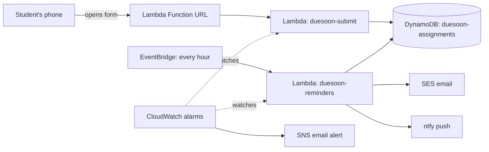

# DueSoon

DueSoon is a serverless reminder app I built to help keep track of school assignments and due dates.

The idea came from wanting something simple my nephew could use to ensure he submits his school work on time and doesn't miss any assignments. He submits an assignment through a basic web form, and DueSoon sends reminders by email and push notification before it is due.

Reminders are sent at:

- 10 days
- 5 days
- 3 days
- 1 day
- 12 hours

The app uses AWS services for the backend and Terraform for deployment.

## Architecture



## Tests

The reminder logic is tested with fake dates:

```
cd backend
python3 test_reminder.py
```

## Deploy

```
cd terraform
terraform init
terraform apply
```

Create `terraform/terraform.tfvars` first (it is not in this repo):

```
passcode        = "..."
sender_email    = "..."
recipient_email = "..."
alarm_email     = "..."
ntfy_topic      = "..."
```

## Break/fix log

| What broke | Cause | Fix |
|---|---|---|
| `terraform plan` said "No configuration files" | Ran it from the project root, not the `terraform` folder | `cd terraform` first |
| `git push` failed with "Permission denied (publickey)" | The remote used SSH, which wasn't set up on this machine | Switched the remote to the HTTPS URL |
| Terraform kept prompting for `var.passcode` | `terraform.tfvars` was saved inside the hidden `.terraform` folder | Moved it next to `main.tf` |
| "Inconsistent dependency lock file" | Added the `archive` provider without re-initializing | `terraform init -upgrade` |
| SNS error "Invalid parameter: Email address" | `alarm_email` was missing, so Terraform prompted and `yes` became the address | Added the variable to `terraform.tfvars` |
| Lambda failed with `Runtime.UserCodeSyntaxError` | The file was truncated when pasted | Fixed the last lines, and now run `python3 -m py_compile` before deploying |
| Reminder emails landed in spam | Sending from a personal address through SES with no DKIM | Marked as not spam for now. Next is sending from my own domain |

## What I learned

This project taught me a lot because I had to connect everything together instead of learning each AWS service on its own.

I learned how Lambda, DynamoDB, EventBridge, SES, SNS and CloudWatch work together to make a real application. I also got more comfortable with Terraform, creating and managing the infrastructure with code instead of clicking through AWS by hand.

The biggest thing was troubleshooting. Most of my problems were small: being in the wrong folder, saving a file in the wrong place, missing a variable, or pasting code that got cut off. But any one of them could stop the whole deployment. I learned to slow down, read the error message, work out what it was actually telling me, and fix one thing at a time.

Dates and time zones taught me something too. Storing everything in UTC and converting only when needed showed me why daylight saving time matters for anything that runs on a schedule.

I also learned that working code isn't the finish line. I had to think about duplicate reminders, what happens when an assignment is added late, what happens if one notification method fails, and about security, permissions and monitoring.

